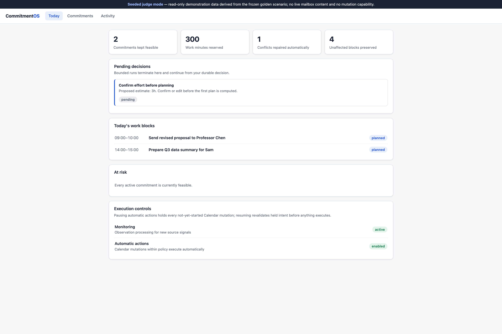
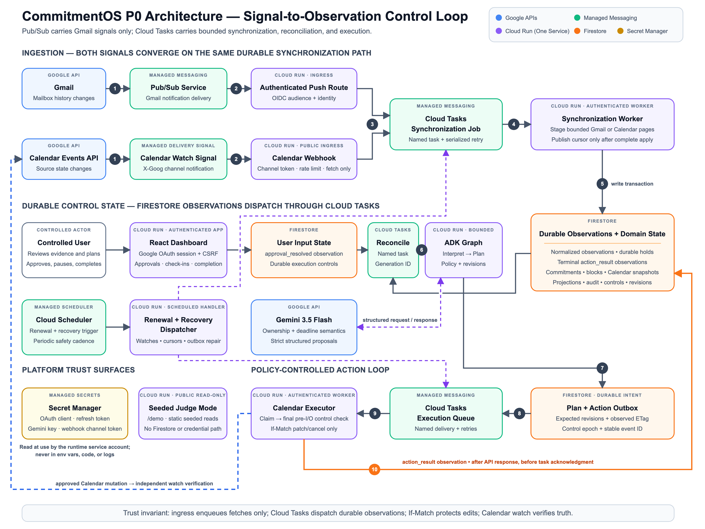

# CommitmentOS

[](https://github.com/dcw06/CommitmentOS/actions/workflows/ci.yml)

Turns promises in Gmail into scheduled work, repairs calendar conflicts, and tracks completion through explicit user check-ins. Gemini interprets ambiguous messages; deterministic code owns scheduling, policies, state changes, and Calendar writes.

**[Try the interactive sandbox](https://commitmentos-2hscowvydq-uw.a.run.app/sandbox) · [Read-only dashboard](https://commitmentos-2hscowvydq-uw.a.run.app/demo) · [Measured evidence](docs/proof_index.md) · [Development guide](docs/OPERATIONS.md)**



## Scope and ownership

Built solo by Chongwei (Alan) Dai for Google's All Things Agentic Hackathon. The implementation includes Gmail/Calendar synchronization, deterministic planning, revision-guarded execution, a React dashboard, and evaluation tooling. AI assistance is retained in commit coauthor attribution.

The live deployment supports **one controlled account**. Visitors can use the isolated sandbox or read-only demo without access to that account. This is a personal deployment, not public multi-user onboarding.

## How it works

Detect commitment → preserve evidence and ownership → confirm effort → reserve calendar time → detect conflict → repair within policy → record verified progress.



FastAPI runs on Cloud Run. Firestore transactions, fenced leases, named Cloud Tasks, stable event IDs, and Calendar `If-Match` guards protect execution. Pub/Sub ingests Gmail notifications; Cloud Scheduler performs maintenance. The frontend uses React and TypeScript.

## Results and their limits

| Measurement | Observed result | Scope |
|---|---|---|
| Live end-to-end campaign | 10/10 runs; 61 checkpoints per run | Real Gmail, live Gemini, and Calendar |
| Post-hardening campaign | 10/10 runs; 50 checkpoints per run | Seeded mode on a later revision |
| Conflict-to-repair latency | Mean 9.1 s; range 7.2–10.2 s | Ten live campaign runs |
| Duplicate commitments/events | 0 observed | The two campaigns above |
| Security checks | 72 live probes + 1 documented rate-limit gate | Specific deployed revision and tested cases |
| Extraction evaluation | 32/32 labeled examples passed | A small fixture suite, not a general accuracy or injection-resistance guarantee |

The [proof index](docs/proof_index.md) binds these historical measurements to revisions, dates, and frozen artifacts. CI checks current source; it does not repeat cloud campaigns.

## Run a local read-only preview

Requires Python 3.14, uv, and Node 22+. No Google credentials or cloud project are needed for this preview.

```bash
git clone https://github.com/dcw06/CommitmentOS.git
cd CommitmentOS
uv sync --frozen
cd frontend
npm ci
npm run build
cd ..
uv run uvicorn --app-dir backend/src commitmentos.local_demo:create_app --factory --host 127.0.0.1 --port 8080
```

Open <http://127.0.0.1:8080/demo>. This entry point serves committed scenario data and rejects demo mutations. It does not expose the interactive sandbox or live-account APIs. Full service setup and owner-operated deployment remain in the [operations guide](docs/OPERATIONS.md).

## Verify

```bash
uv run pytest
uv run ruff check .
cd frontend
npm test
npm run build
```

Tests use in-memory adapters; they do not require cloud credentials. No deployment is performed by CI.

## Limitations

- Sandbox surrounding services are simulated; custom-message interpretation calls the separate sandbox model.
- Completion requires explicit check-in; elapsed calendar time is not proof of work.
- Multi-user onboarding, dependency planning, and public OAuth verification are outside this release.
- Frozen results establish behavior in their measured scenarios, not reliability under every failure or workload.
